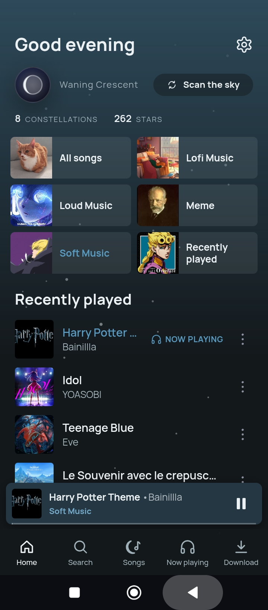
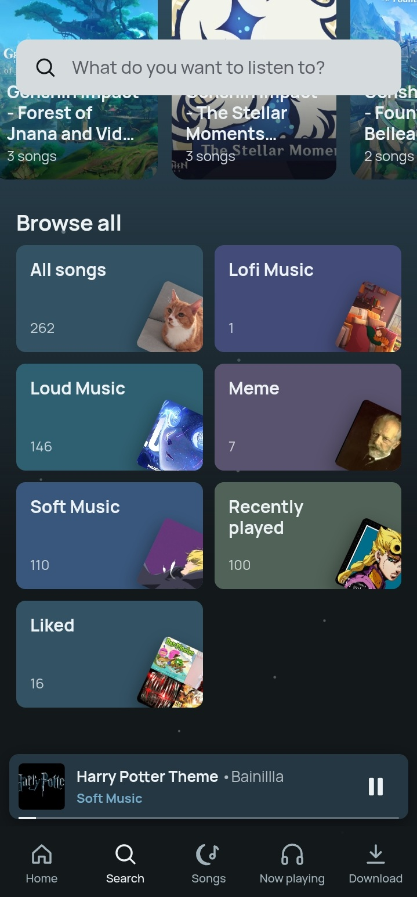
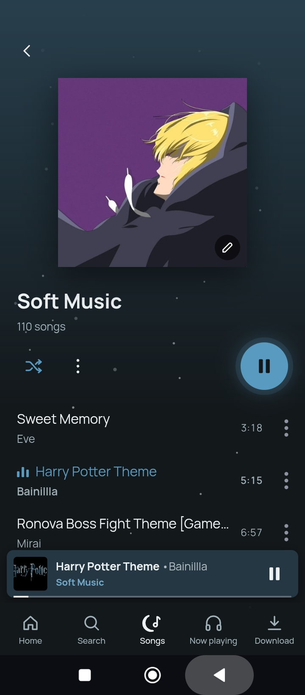
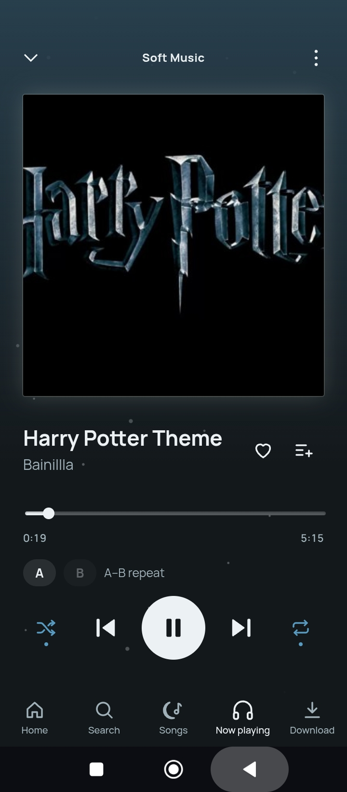
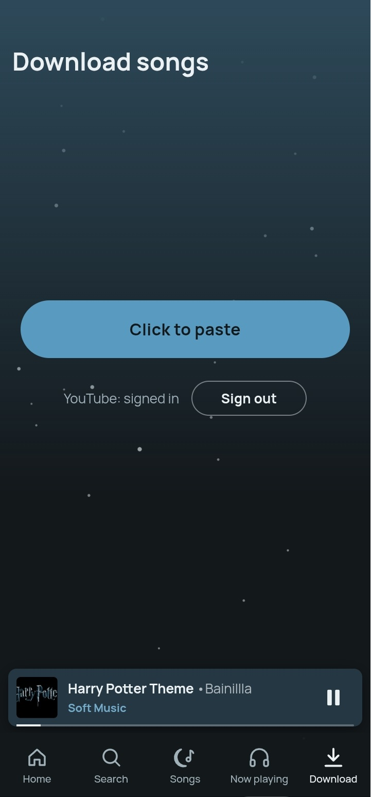

<div align="center">

# 🌙 Moonlight

**A Spotify-style offline music player for Android, with a moon-and-stars theme.**

Plays the music already on your phone, keeps going in the background, and can download songs from links and file them into playlists for you.


[Download](https://github.com/ScellyP/Moon-light/releases) · [Features](#-features) · [Install](#-installation) · [Build](#-building-from-source) · [AI disclosure](#-ai-disclosure)

</div>

---

## About

Moonlight began as the music panel of my **Novel Reader** app and grew into an app of its own, with its own package (`com.scell.moonlight`), signed APKs and in-app updates from GitHub Releases.

It is a **learning project**. I built it to learn **JavaScript** (the whole UI is plain JS in a WebView) and to see how an app, a native host, background audio and CI/CD fit together. AI helped a lot along the way; exactly how, and which parts I wrote myself, is described in the [AI disclosure](#-ai-disclosure).

## Table of contents

- [Features](#-features)
- [Screens](#-screens)
- [Installation](#-installation)
- [Permissions](#-permissions)
- [Updating](#-updating)
- [Your data](#-your-settings-and-song-lists)
- [Tech stack](#-tech-stack)
- [Architecture](#-architecture)
- [Project structure](#-project-structure)
- [Building from source](#-building-from-source)
- [Testing](#-testing)
- [Release process](#-release-process)
- [Known limitations](#-known-limitations)
- [Legal note](#-legal-note)
- [AI disclosure](#-ai-disclosure)
- [Credits](#-credits)

---

## ✨ Features

### Playback
- **Background playback** with the screen off or the app closed (Media3 / ExoPlayer in a foreground service).
- **Notification and lock-screen controls** with artwork, title/artist, play/pause, next/previous.
- **Bluetooth and headset buttons**; playback pauses when headphones or Bluetooth disconnect.
- **Audio focus handling**: ducks or pauses for calls and other apps.
- **Near-gapless playback**: the next track is pre-buffered while the current one plays.
- **Crossfade**: overlap tracks by 1–12 seconds on an equal-power curve, so loudness stays steady.
- **Volume normalisation (ReplayGain)**: Off / Track / Album. Reads tags already in your files (ID3v2, APEv2, FLAC/Vorbis/Opus comments, iTunes-style M4A atoms) and never boosts past the point of clipping.
- **A-B repeat** to loop a section of a song.
- **Sleep timer**: stop after N minutes or at the end of the current track, with a fade-out.
- **Unplayable files are skipped** instead of stalling the player.
- **Muting the phone pauses the music**, and it resumes when the volume comes back up.
- **Remembers the last song** and has it ready (not started) on the next launch.
- **Optional auto-start over Bluetooth.**

### Library and organisation
- **Library scan** reads folders and tags (title, artist, album, cover art). Tap **Scan the sky** on Home to rescan.
- **Folder playlists**: every sub-folder becomes a playlist. You can also create **your own playlists**.
- **Liked songs** and **Recently played** (newest first, up to 100).
- **Visible "up next" queue.**
- **Shuffle in rounds**: every song plays once, in random order, before any repeats, and the app remembers this even after you close it. **Repeat** has three modes: off / all / one.
- **Song options menu** (the `⋮` next to any song): edit info, share, like, add to playlist, move/remove, add to queue, loop, delete.
- **Edit song info** (title, artist, album). Edits are an overlay saved in `song-edits.json`, so the music file and its tags are never rewritten, and *Reset to the file's info* always brings the original back.
- **Custom playlist covers**: tap the pencil on a playlist's cover to pick your own picture; it wins over the automatic mosaic.
- **Duplicate clean-up**: copies of the same song (same title and artist, or same source link) are merged after a scan. Extra copies are *moved* to `Moonlight/Duplicates`, never deleted, and it can be switched off in Settings.
- **Share** a song's file (the mp3) through Android's share sheet, or just the link it was downloaded from.
- **Delete** a song's file for good (after a confirmation), which is different from *Remove from this playlist*.

### Download songs
- Paste links from the clipboard (up to 50 at a time); each becomes a queued song.
- A **bundled yt-dlp (with Python and ffmpeg)** downloads audio and converts it to MP3 with tags and cover art. No other app is needed.
- Step-by-step wizard per song: **download → name it → pick a playlist → place it**. The next song downloads in the background while you name the current one.
- **Remembers what you downloaded** and warns *Already downloaded* even if the link is written differently.
- **Duplicate-name detection** while you name a song, ignoring capitals, punctuation and tags like "(Official Video)".
- **Crop the cover**: choose which square of the video's thumbnail becomes the song's cover art.
- **YouTube sign-in** (optional): the Download tab shows *YouTube: signed in / Sign out*. Signing in lets yt-dlp get past YouTube's "confirm you're not a bot" check. You type your password into Google's own page, and the cookies stay in the app's private storage. Google can refuse sign-in inside an app's web view; if so, put a `cookies.txt` exported from your browser in the `Moonlight` folder instead.
- yt-dlp **updates itself** after a failed download, since sites change often.

### Search
- Spotify-style **Search** tab with results as you type: top result, songs, playlists, artists.
- Typo-tolerant and accent/punctuation-insensitive (`lofi` finds `Lo-fi`), with the matched letters highlighted.
- Filter chips, recent searches, and a Browse-all grid.

### Look and feel
- Spotify-style mini player, action sheet, album/playlist headers and 2×2 cover mosaics.
- **Cover-art tint**: the UI takes its colours from the current cover.
- **Moon theme** with twinkling stars and a **live moon-phase badge** showing today's real phase.
- Time-based greeting on Home, a "Made for you" shelf, and your **Constellations** (playlists).
- Bundled fonts (Lora, Newsreader, Manrope, Atkinson) so it looks identical offline.
- Optimised for large libraries (indexed lookups, off-screen rows skipped by the renderer).

### Settings menu
Swipe right on Home (or tap the gear) for a drawer with playback options (normalisation, crossfade, Bluetooth auto-start), appearance options (twinkling stars, cover colours) and the update controls.

### Updates
- Checks this repo's **GitHub Releases** on start and in the background about every 6 hours (Wi-Fi only), with no Firebase or server needed.
- Never installs while music is playing or a download is running.
- APK size and SHA-256 are verified before install, and Android always has the final say.

---

## 📱 Screens

| Tab | What it does |
| --- | --- |
| <br><br>**Home Tab** | • Greeting<br>• Current moon phase<br>• Quick tiles<br>• Made for you<br>• Playlists<br>• Scan for songs<br>• Settings |
| <br><br>**Search Tab** | • Search songs, playlists and artists as you type<br>• Recent searches<br>• Browse all |
| <br><br>**Songs Tab** | • The full library<br>• Playlists<br>• The visible queue |
| <br><br>**Now playing Tab** | • Artwork<br>• Seek bar<br>• Like<br>• Shuffle/repeat<br>• A-B repeat<br>• Volume<br>• Sleep timer |
| <br><br>**Download Tab** | • The paste-a-link song download wizard<br>• YouTube sign-in |

---

## 📦 Installation

1. Go to [**Releases**](https://github.com/ScellyP/Moon-light/releases) and download `moonlight-vX.Y.Z.apk`.
   > Builds from the **Actions** tab are work-in-progress and can break in funny ways. Use Releases unless you want to test.
2. Install it and allow **All files access** (Android 11+) and **notifications** (Android 13+) when asked.
3. Put your music in `Novel/Audio` (or `Moonlight/Songs`), open the app, and tap **Scan the sky** on Home if nothing shows up.

**Requirements:** Android 7.0 (API 24) or newer. Builds target `arm64-v8a` and `armeabi-v7a` (real phones). For x86 emulators, change the ABI filter in `app/build.gradle`.

## 🔐 Permissions

| Permission | Why |
| --- | --- |
| `READ_EXTERNAL_STORAGE` (Android 12 and older) / `MANAGE_EXTERNAL_STORAGE` | Read your music and create the app folders |
| `WRITE_EXTERNAL_STORAGE` (Android 10 and older) | Create the music folder where "all files access" doesn't exist |
| `FOREGROUND_SERVICE`, `FOREGROUND_SERVICE_MEDIA_PLAYBACK` | Background playback |
| `POST_NOTIFICATIONS` | Media notification (Android 13+) |
| `INTERNET` | Song downloads and update checks (nothing else uses the network) |
| `ACCESS_NETWORK_STATE` | Skip automatic update downloads on mobile data |
| `REQUEST_INSTALL_PACKAGES` | Install the updated APK |
| `RECEIVE_BOOT_COMPLETED` | Keep the background update check scheduled after a reboot |

## 🔄 Updating

The app checks GitHub Releases when it starts and, in the background, about every 6 hours. If a newer version exists it downloads on Wi-Fi and offers **Install** at the bottom of the Settings menu. Android asks you to confirm, and the first time to allow *Install unknown apps* for Moonlight. Later updates can be silent on Android 12+. Turn off **Update automatically** to stop all background checking.

Prefer Termux? `tools/update-moonlight.sh` downloads the newest release, verifies its checksum and installs it (root, Shizuku, or the normal Android installer). Options such as `--check` (only report the newest version) and `--force` are documented at the top of the script.

## 🗂 Your settings and song lists

Everything lives in `/storage/emulated/0/Moonlight/`. Copy it to a new phone and the app picks up where it left off.

```
Songs/              every song downloaded from now on (one shared folder)
playlists/          one readable JSON file per playlist (plus a .bak of the last good copy)
playlist-covers/    the cover pictures you chose for playlists
Duplicates/         extra copies moved out of the way by the duplicate clean-up
settings.txt        your settings (audio.* lines); editable while the app is closed
downloads.txt       every song downloaded from a link: date, saved name, playlist, link, file path
favorites.txt       liked songs: date, title, artist, album, playlist, length, file path
recents.txt         recently played songs (newest first, up to 100)
song-edits.json     your edits to song titles, artists and albums
cookies.txt         (optional) your own browser cookies for yt-dlp
```

The `.txt` files are plain, tab-separated text with a `#` comment header, so they open in any editor or spreadsheet. If the app's own data is ever empty (fresh install, cleared data) it restores favourites and recents from them on the first scan. The old music folder (`Novel/Audio`) is still read and never modified.

---

## 🧰 Tech stack

| Part | Technology |
| --- | --- |
| UI | HTML / CSS / JavaScript in an Android **WebView**, served from `https://appassets.androidplatform.net/` via `WebViewAssetLoader` |
| Native host | **Kotlin**, compileSdk/targetSdk 34, minSdk 24 |
| Playback | **Media3 ExoPlayer 1.4.1** + **media3-session** |
| Playback engines | WebView `<audio>` and native ExoPlayer, switching mid-song inaudibly |
| Downloads | **youtubedl-android 0.18.1** (yt-dlp + Python + ffmpeg) |
| Build / CI | Gradle (AGP 8.5), Java 17, **GitHub Actions** |
| Shrinking | R8 (no obfuscation, so crash logs stay readable) |
| Tests | Node (`tests/*.test.js`) and a small JVM test for ID3 handling |

## 🏗 Architecture

```
┌──────────────────────────── Android app ─────────────────────────────┐
│                                                                      │
│  WebView (UI)                         Kotlin (native)                │
│  ├─ spotify-ui.js   tabs, mini player ├─ MainActivity   bridge, scan │
│  ├─ audio-player.js queue, library    ├─ PlaybackService Media3 svc  │
│  ├─ song-search.js  search            ├─ NativeCrossfade 2 players   │
│  ├─ song-download.js wizard   ◄─────► ├─ SongDownloader  yt-dlp      │
│  ├─ song-memory.js  txt files   JS    ├─ ReplayGainReader tags       │
│  ├─ song-menu.js    ⋮ options   bridge ├─ SongLibrary / SongEdits     │
│  └─ settings-menu.js drawer           └─ AppUpdater / BackgroundUpd. │
│                                                                      │
└──────────────────────────────────────────────────────────────────────┘
```

The page talks to Kotlin through a single `AndroidBridge`. `tests/player-app.test.js` checks that the page and `MainActivity` agree on every bridge and callback name.

## 📁 Project structure

```
Moon-light/
├── app/src/main/
│   ├── java/com/scell/moonlight/   Kotlin: MainActivity, PlaybackService, SongDownloader, SongLibrary,
│   │                               SongEdits, PlaylistCovers, YouTubeSignIn, updaters, tag readers
│   ├── assets/                     The web UI: index.html, *.js (audio-player, spotify-ui, song-search,
│   │                               song-download, song-menu, settings-menu, ...), fonts/
│   ├── res/                        Icons, colours, themes
│   └── AndroidManifest.xml
├── docs/                           README screenshots
├── tests/                          Node + JVM tests
├── tools/update-moonlight.sh       Termux updater
├── .github/workflows/build-apk.yml CI: build, sign, publish Release
├── Agent.md                        Developer / AI-assistant notes and change log
└── README.md
```

---

## 🔨 Building from source

**Prerequisites:** JDK 17 and the Android SDK (platform 34, build-tools 34.0.0).

```bash
git clone https://github.com/ScellyP/Moon-light.git
cd Moon-light
./gradlew assembleDebug        # APK at app/build/outputs/apk/debug/app-debug.apk
./gradlew assembleRelease      # minified build
```

**Signing:** the key is **not** in the repo. CI reads four secrets (`ANDROID_KEYSTORE_BASE64`, `ANDROID_KEYSTORE_PASSWORD`, `ANDROID_KEY_ALIAS`, `ANDROID_KEY_PASSWORD`). Without them the build falls back to Android's debug key. That APK installs fine, but it **cannot update** an app that was installed from a build signed with the real key.

## ✅ Testing

```bash
for t in tests/*.test.js; do node "$t" || echo "FAILED: $t"; done
```

The tests cover playback and shuffle logic, search ranking, download memory and duplicate detection, song sharing, the settings drawer gesture, the update flow, and the page/native bridge contract.

> Note: the Node tests exercise the web UI and the bridge contract; the Kotlin side is verified by CI builds and manual testing on a phone, and some recent native changes (such as sharing) have had limited device testing. Bug reports are welcome.

## 🚀 Release process

- A push to `main` **only builds if a commit message contains a version like `v1.04.05`**. Docs-only commits skip the build. A manual run from the Actions tab always builds.
- The version lives in one place, `app/src/main/assets/version.js` (`vMAJOR.MID.MINOR`), and is bumped by hand.
- CI signs the APK and publishes `moonlight-vX.Y.Z.apk` as a GitHub Release, which is what the in-app updater reads.

See [`Agent.md`](Agent.md) for the full developer notes and structure change log.

---

## ⚠️ Known limitations

- Playback speed control and per-track resume-at-position were removed. Playback is always 1×, and each track starts from 0. This is how it will be in all future versions and will not be updated.
- The music folder is fixed (`Novel/Audio` and `Moonlight/Songs`); there is no folder picker yet.
- Song edits are stored by file name + size, so renaming or replacing a file starts its edits fresh.
- Downloads depend on yt-dlp working with the site. Sites change; the app updates yt-dlp automatically after a failure.

## ⚖️ Legal note

The download feature is a general-purpose front end for [yt-dlp](https://github.com/yt-dlp/yt-dlp). Downloading content may violate a website's terms of service or copyright law depending on where you live and what you download. **Only download content you have the right to.** This project does not host or distribute any media and is not affiliated with any streaming service.

---

## 🤖 AI disclosure

This project was built **with AI assistance**. It is also a project where I'm actively learning, so here is how the work really splits.

| | |
| --- | --- |
| **Tools** | Claude (Anthropic), in chat for the JavaScript and as an agentic coding assistant (Claude Code) for larger tasks |
| **JavaScript (the UI)** | This is the part I'm learning, and the part I work on myself. Most of it started from code I worked out with Claude. I read what Claude writes, **type it out by hand** instead of pasting, run it, and then add my own code in the same style. Typing it myself is how I get the language and the structure to stick |
| **Kotlin (the native side)** | I don't write this. Playback service, downloader, updater, tag readers and the bridge were written by the AI. I can read them and test them on my phone, but I'm not claiming I wrote them |
| **Documentation** | This README, `Agent.md` and the code comments are mainly written by the AI. I review them, but I did not write most of the text |
| **What I did** | Chose what to build and how it should behave, reviewed diffs, typed out and extended the JS, tested on a real phone, approved merges, and decided what shipped |
| **Why I'm sharing this** | It's a learning project. I use the AI as a tutor and pair-programmer to learn JavaScript, and to pick up Android, Media3, WebView bridging and GitHub Actions along the way |
| **Accountability** | I am responsible for this project's content, accuracy and fitness for purpose |

`Agent.md` contains the instructions the AI follows in this repo and a dated log of every structural change with the reason, so the development process is open to read.

---

## 🙏 Credits

Moonlight stands on other people's work. Each project keeps its own licence.

**Playback and Android**
- [Media3 / ExoPlayer and Media3 Session](https://developer.android.com/media/media3) for playback, the media notification and lock-screen controls
- [AndroidX](https://developer.android.com/jetpack/androidx) (Activity, Core, DocumentFile, WebKit)

**Song downloads**
- [yt-dlp](https://github.com/yt-dlp/yt-dlp), kept on the [nightly builds](https://github.com/yt-dlp/yt-dlp-nightly-builds) because sites change faster than stable releases
- [youtubedl-android](https://github.com/JunkFood02/youtubedl-android) by JunkFood02, and the [original project](https://github.com/yausername/youtubedl-android) by yausername, which bundle Python and [FFmpeg](https://ffmpeg.org)

**Fonts:** Lora, Newsreader, Manrope, Atkinson

---

<div align="center">

Made by Chirag · If you like it, a ⭐ helps

</div>
